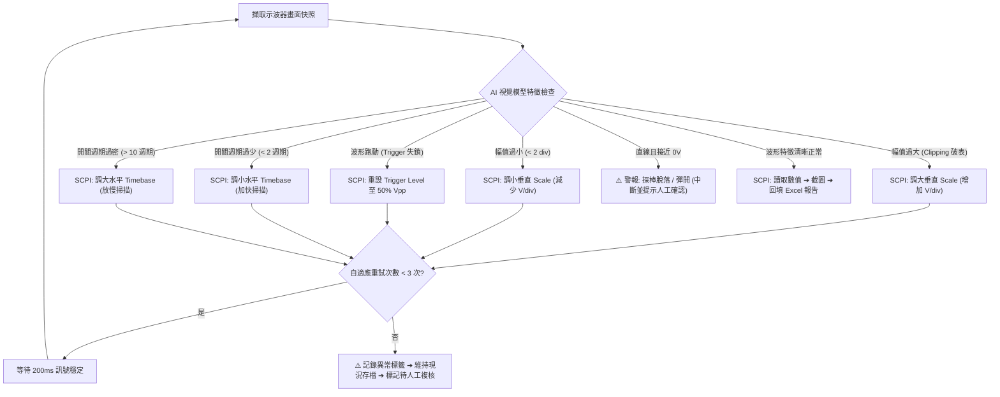

# VR / POL 電源測試專題匯報與 AI 自適應量測演進提案

> **文件定位**：本文件整理自硬體/電源驗證工程團隊內部技術匯報與架構評審。包含 10 分鐘專題簡報大綱、現場實戰逐字講稿、MECE 異常處理架構、兩階段落地路線圖（API 快速驗證試水溫 ➔ 本地離線部署）與主管問答攻防劇本。  
> **核心目標**：解決目前電源測試「八成時間耗在調旋鈕與填 Excel」的痛點，從現有 Python 半自動化引擎出發，逐步過渡到具備視覺反饋與閉環**自適應調整**能力的自主量測系統。

---

## 📑 目錄 (Table of Contents)

1. [專案背景與痛點剖析](#1-專案背景與痛點剖析)
2. [技術可行性與邊界評估](#2-技術可行性與邊界評估)
3. [10 分鐘專題匯報：投影片大綱與逐字講稿](#3-10-分鐘專題匯報投影片大綱與逐字講稿)
   - [Slide 1: 現況痛點與主題切入](#slide-1-現況痛點與主題切入)
   - [Slide 2: 現場痛點三大常客（腳本只管抓圖，不管抓得對不對）](#slide-2-現場痛點三大常客腳本只管抓圖不管抓得對不對)
   - [Slide 3: 核心解法：多模態視覺判讀（雙軌分工架構）](#slide-3-核心解法多模態視覺判讀雙軌分工架構)
   - [Slide 4: 自適應機制：有限次數的自適應重測閉環](#slide-4-自適應機制有限次數的自適應重測閉環)
   - [Slide 5: 務實落地：兩階段規劃（API 快速驗證試水溫 ➔ 本機離線）](#slide-5-務實落地兩階段規劃api-快速驗證試水溫--本機離線)
   - [Slide 6: 延伸價值：異常波形智慧排障與老鳥經驗資產化](#slide-6-延伸價值異常波形智慧排障與老鳥經驗資產化)
   - [Slide 7: 結論與資源請求（打通最後物理斷點）](#slide-7-結論與資源請求打通最後物理斷點)
4. [MECE 異常自適應處方矩陣](#4-mece-異常自適應處方矩陣)
5. [高階主管 Q&A 實戰攻防劇本](#5-高階主管-qa-實戰攻防劇本)

---

## 1. 專案背景與痛點剖析

在伺服器主機板與高效能運算平台中，電壓調節模組（Voltage Regulator, VR）與負載點轉換器（Point of Load, POL）的測試項目繁多且嚴苛。涵蓋 Ripple & Noise、Dynamic Transient、FSW、MOSFET Vds Switching Waveforms、Jitter、OCP、SCP 與 Turn-on/off Sequence 等。

工程現場真實挑戰：
- **大量低價值重複勞動**：一套完整的測試矩陣常包含十餘項 Rail、多種負載模式與溫度條件。工程師測試 8 小時，往往有超過 5 小時在手動切換示波器 Timebase/Scale、調整電子負載、存檔截圖、複製貼上儲存格。
- **傳統純腳本的脆弱性**：純 SCPI 自動化腳本在理想狀態下運作良好，但缺乏「眼睛與常識」。一旦探棒彈開、訊號垂直過載（Clipping）或接地雜訊突發，傳統腳本無法自我修正，往往直接儲存無效圖檔或拋出 Timeout 異常而崩潰中斷。
- **事後重測成本高昂**：跑完 50 個測項後，工程師仍需肉眼逐頁挑錯；一旦發現抓錯一張，整套治具與環境往往需要重新架設、重新測試。

---

## 2. 技術可行性與邊界評估

導入多模態 AI 輔助示波器操作並非空想，但必須劃清「可行」與「不可行」的工程界線：

| 評估維度 | 目前技術「可行」範圍 (Feasible) | 目前技術「不可行」或高風險範圍 (Non-feasible / Out of Scope) |
| :--- | :--- | :--- |
| **視覺判讀能力** | 示波器螢幕特徵辨識：波形截頭（破表）、波形振幅太小（< 2 div）、底噪過大、Trigger 失鎖浮動、文字/量測欄位缺失。 | 靠肉眼算像素來取代示波器內部 12-bit ADC 硬體量測值（絕對禁止，數值必須回歸儀器 SCPI 讀取）。 |
| **自適應控制能力** | 參數微調（V/div、s/div、Trigger Level、Position）的試錯修正，能在 3 次疊代內將波形調至可量測區間。 | 全自動無人值守測試高風險測項（如 OCP、SCP、極限短路），此類測試必須保留工程師實體在場與硬體保護極限。 |
| **系統反應延遲** | 步驟間 1~2 秒的視覺模型推論延遲（對於總長數小時的驗證流程完全可接受）。 | 毫秒等級的即時硬體保護反饋（安全防護必須走實體線路與硬體 OVP/OCP 機制）。 |
| **資安與部署** | Phase 1 使用本機腳本 + 脫敏圖片呼叫公有 API 進行快速驗證試水溫；Phase 2 部署本機 4090 工作站（Ollama / vLLM）完全斷網運作。 | 將包含客戶未公開規格與機密線路名稱的完整報告直連未經核准的第三方伺服器。 |

---

## 3. 10 分鐘專題匯報：投影片大綱與逐字講稿

---

### Slide 1: 現況痛點與主題切入
- **投影片標題**：從「腳本代工」到「能自己判斷的測試系統」
- **副標題**：破局現場痛點：為什麼連上負載機還不夠？如何讓系統自己看懂波形抓得對不對
- **匯報人**：RD 測試與自動化團隊 ｜ 匯報時長：10 分鐘
- **內容重點**：
  - **第一階段成果**：半自動化已省下 70% 時間（示波器自動抓圖 ＋ 數值自動回填 Excel，消除手工抄寫，量測格式完全標準化）。
  - **下一個瓶頸**：光把儀器連線，人還是不敢走開（示波器常抓到空白、雜訊或切頭廢圖；若無人盯螢幕，事後重看重測更浪費時間）。
  - **解法與路徑**：幫測試腳本裝上「眼睛」（視覺 AI 當場檢查波形 ＋ 自適應重測，API 快速驗證試水溫 ➔ 本地離線 100% 保密）。

#### 🎙️ 台上逐字稿 (Slide 1，約 1.5 分鐘)
> 「各位主管、各位同仁好。  
> 
> 今天我想直接切入大家在 Lab 每天都在經歷的痛點：VR 和 POL 的測試。  
> 
> 過去這段時間，我們團隊完成了第一階段的 SemiAutoRunner 半自動化，已經成功幫大家省下 70% 的手動抄寫與排版時間。但是，我們很快遇到了下一個瓶頸：**就算儀器連上線了，工程師依然不敢離開機台**。  
> 
> 為什麼？因為示波器常常抓到空白、切頭或滿是雜訊的廢圖。如果沒人在旁邊盯著螢幕，跑完幾十個測項後才發現抓錯，整套治具又要重新架設重測，反而浪費更多時間。  
> 
> 我們今天提出的核心概念很明確：**幫測試腳本裝上『眼睛』**。讓系統具備視覺能力，在存檔那一瞬間先自己檢查一眼，抓錯就當場自適應調整重測。我們採取『API 快速驗證試水溫 ➔ 本機離線 100% 保密』的務實路徑，把工程師的時間真正還給電路設計與 Debug。」

---

### Slide 2: 現場痛點三大常客（腳本只管抓圖，不管抓得對不對）
- **投影片標題**：現場三大常客：腳本只管抓圖，不管抓得對不對
- **內容重點**：
  - **常客一：觸發跑掉 (Trigger Drift)**  
    工況切換時訊號抖動，示波器沒觸發到；抓下來變成直線、空白或非穩態波形；腳本時間一到就按截圖，不知道抓錯。
  - **常客二：接地雜訊 (Ground Noise)**  
    測試治具氧化、接觸不良、地線稍長；高頻雜訊全收進來，波形長滿毛刺，掩蓋了真正的電源切換行為。
  - **常客三：假性合格 (False Pass)**  
    示波器回傳 Vpp 數字看似在規格內，但肉眼一看波形後面在 ringing 振盪；傳統腳本只讀數字，放過致命設計缺陷。
  - **後果**：跑完 50 個測項，工程師還是得逐頁翻看肉眼挑錯；抓錯一張就要全套重架重測！

#### 🎙️ 台上逐字稿 (Slide 2，約 1.5 分鐘)
> 「我們在現場最常被這三大問題折磨：  
> 
> 第一個常客是**『觸發跑掉』**：抽載切換時訊號一晃動，示波器沒觸發到，畫面上只剩一條平線。傳統腳本時間一到就只管截圖，根本不知道自己抓了一張白紙。  
> 
> 第二個常客是**『接地雜訊』**：治具探棒稍微鬆脫或接地線過長，高頻雜訊全灌進來，整條波形長滿毛刺，根本分不清是真正的 Ripple 還是量測噪訊。  
> 
> 第三個最危險，叫做**『假性合格』**：示波器讀回來的 Vpp 數值看似符合規範，但波形尾端其實已經在劇烈 ringing 振盪。純數值腳本直接判定 Pass，放過致命的電路穩定度缺陷。  
> 
> 結果就是，即使跑完了 50 個測項，工程師最後還是得一張一張肉眼挑錯，只要抓錯一張，整張板子又得重測一次。」

---

### Slide 3: 核心解法：多模態視覺判讀（雙軌分工架構）
- **投影片標題**：多模態視覺判讀：讓系統在存檔前，先自己檢查一眼
- **內容重點**：
  - **數值層（繼續用 SCPI 指令讀取）**：
    - 精確測量數值（維持最高硬體精度，絕不讓 AI 猜數字）。
    - Vpp、Vmax、Vmin 峰值電壓、切換頻率 (FSW)、轉換效率與上升/下降時間。
    - ➔ 保持傳統量測嚴謹度，杜絕數值型 AI 幻覺。
  - **行為層（AI 視覺模型當眼睛把關）**：
    - 波形品質與行為判別（防呆防錯，目標準確率 >90%）。
    - 截圖有效性：波形破表、切頭 (Clipping)、未觸發檢查。
    - 行為合理性：及時發現接觸不良與異常高頻雜訊。
    - 當場防禦：判定不合規立即觸發**自適應調整**，不留髒數據。
  - **雙軌分工**：數值走儀器、品質走 AI，互不干擾。
  - **核心邏輯**：示波器抓圖的一秒內，AI 先掃一眼確認沒廢圖再填 Excel，把問題消滅在當場！

#### 🎙️ 台上逐字稿 (Slide 3，約 1.5 分鐘)
> 「面對這個痛點，我們的解法不是讓 AI 去取代一切，而是採取**『雙軌分工』**：  
> 
> **數值層歸儀器，行為層歸 AI**。  
> 
> 所有的 Vpp、頻率、上升時間，一律繼續用標準 SCPI 指令從示波器內部 12-bit 硬體讀出來。我們絕不讓 AI 去看圖猜數字，徹底杜絕任何模型幻覺。  
> 
> AI 的唯一職責，就是當我們的『視覺把關眼睛』。在截圖完成的一秒鐘之內，AI 快速掃描螢幕：波形有沒有切頭破表？Trigger 有沒有咬住？有沒有滿地毛刺？如果波形健康，立即存檔；如果發現異常，當場啟動自適應調整重測。把所有廢圖與無效量測，在當場就消滅掉。」

---

### Slide 4: 自適應機制：有限次數的自適應重測閉環
- **投影片標題**：遇到異常怎麼辦？有限次數的「自適應重測」閉環
- **內容重點**：
  - **01 波形抓取與審查**：示波器完成截圖 ➔ 視覺 AI 即時審查品質 ➔ 判定正常直接存檔。
  - **02 現場自適應調整**：
    - 若波形破表 ➔ 垂直檔位退一格（增加 V/div）。
    - 若觸發偏移 ➔ 重設 50% Level。
    - 若時基不適 ➔ 微調 Time/div。
  - **03 最多重試 3 次**：自適應後重新抓圖，設定上限最多 3 次，絕不陷入死循環卡死機台。
  - **04 真異常留存標註**：若連測 3 次波形仍怪異，判定為電路真故障（非儀器問題），標註警示紅燈，跳下一測項。
  - **規則保障**：儀器沒設好就現場調好；板子真有問題就標註留證，兼顧自動化速度與測試完整度！

#### 🎙️ 台上逐字稿 (Slide 4，約 1.5 分鐘)
> 「那麼，當系統看到異常時具體怎麼做？我們設計了四步驟的**『自適應重測』閉環**：  
> 
> 第一步抓圖審查，如果正常就直接寫入 Excel；  
> 第二步，如果看到切頭，系統自動送 SCPI 把垂直檔位退一格；如果觸發跑掉，自動把 Trigger 重新鎖定在 50% 位置；  
> 第三步，我們設定了**嚴格的 3 次重試上限**，自適應微調最多試 3 次，絕對不會發生程式卡死在死循環裡的狀況；  
> 第四步，如果連續 3 次調整都還是怪異波形，系統會判定這不是儀器沒設好，而是這塊板子的電路真的出問題了！這時系統會直接標記警示紅燈、保存原始圖證，然後優雅地跳到下一個測項繼續跑。  
> 
> 儀器沒調好，系統當場搞定；板子有缺陷，系統精準抓出來留證。」

---

### Slide 5: 務實落地：兩階段規劃（API 快速驗證試水溫 ➔ 本機離線）
- **投影片標題**：兩階段落地：零硬體成本驗證 ➔ 本地離線部署
- **內容重點**：
  - **第一階段：多模態 API 快速驗證試水溫（現在進行）**
    - 零硬體預算：現有 Python 環境直接串多模態 API。
    - 成本極低：測一張圖幾分錢，測完整塊板子不到幾十塊。
    - 任務目標：快速調教波形判讀 Prompt 與自適應重測邏輯。
    - 效益確認：確認準確率達到 90%+ 再申請後續硬體。
  - **第二階段：實驗室本地工作站離線部署（成熟後）**
    - 預算精準：組一台約 10~15 萬工作站（如 RTX 4090 24GB）。
    - 開源模型地端化：部署開源多模態模型（如 Qwen-VL / Ollama）。
    - 100% 斷網運行：測試波形與專利參數絕不連外網，零資安外洩疑慮。
    - 極速反應：內網推論單張圖 <0.5 秒，完全跟上量測節奏。
  - **主管效益**：先花幾十塊證明有效（嚴控預算） ➔ 再買十幾萬工作站（守護公司機密）。

#### 🎙️ 台上逐字稿 (Slide 5，約 1.5 分鐘)
> 「在導入時程與資源上，我們採取最務實的兩階段路線：  
> 
> **第一階段是『快速驗證試水溫』**。我們今天不需要去跟部門要大筆硬體預算，直接在現有環境串接多模態 API。判讀一張波形圖只要幾分錢台幣，整塊板子測完花不到幾十塊錢。我們先用極低成本把波形判讀的 Prompt 與自適應重測邏輯調校到 90% 以上的準確度。  
> 
> **第二階段是『本地離線部署』**。當第一階段效益被數據驗證之後，我們才提出配置一台 10 到 15 萬的 RTX 4090 本地工作站。我們在地端跑開源視覺模型，整台主機實體斷開外網，波形和板子規格 100% 留在實驗室內網，資安稽核完全合規，而且單張推論速度低於 0.5 秒。  
> 
> 先花幾十塊證明有效，再投十幾萬工作站守護公司機密，這對部門來說是風險最低、效益最明確的投資。」

---

### Slide 6: 延伸價值：異常波形智慧排障與老鳥經驗資產化
- **投影片標題**：不只是測完就算：異常波形的智慧輔助排障
- **內容重點**：
  - **典型故障波形資料庫**：
    - 累積典型異常案例：動態響應下陷過深 (Undershoot)、環路過衝與振盪 (Ringing)、相位抖動與開關不穩定。
    - 建立標準化比對庫。
  - **智慧縮小排查範圍**：
    - 當波形確認是線路問題時，AI 自動比對歷史案例相似度。
    - 提示可能方向（如：補償電路不足、輸出電容實際容值降額過多、電感飽和）。
    - 輔助新進工程師快速定位問題核心。
  - **老鳥經驗資產化**：
    - 減輕資深 RD 重複被問問題的負擔。
    - 把資深前輩腦袋中的 Debug 直覺「寫進系統」。
    - 讓系統像老鳥坐在新人旁邊幫忙把關。
  - **定位清楚**：AI 不是取代工程師下決定，而是幫忙縮小排查範圍，節省摸索時間！

#### 🎙️ 台上逐字稿 (Slide 6，約 1.5 分鐘)
> 「除了自動跑測試，這套系統還有一個更具戰略價值的延伸效益 —— **老鳥經驗資產化**。  
> 
> 在實驗室裡，資深 RD 常常花很多時間幫新進人員看波形：『你看這個波形後面在晃，十之八九是補償沒調好』、『這個 undershoot 掉太深，應該是電容降額沒抓夠』。  
> 
> 我們可以把這些判讀直覺沉澱進系統的故障資料庫。當系統測到異常時，它不僅記錄下來，還能比對歷史特徵，直接提示新人：『類似特徵有 80% 機率與環路補償不足相關』。  
> 
> 我們的定位非常清楚：AI 不是要替工程師做設計決策，而是幫新人把排查範圍從大海撈針縮小到兩個可能原因，直接減輕資深同仁被重複打擾的負擔，將團隊的技術知識真正變成公司的固定資產。」

---

### Slide 7: 結論與資源請求（打通最後物理斷點）
- **投影片標題**：我們需要什麼資源？能換回什麼效益？
- **內容重點**：
  - **核心硬體請求**：借調/採購 1 台可程控電子負載機。
    - **原因 1：打通全自動化最後的物理斷點**：消除目前唯一需要人工手動轉旋鈕切負載的限制。
    - **原因 2：讓 AI 自適應重測真正能動手執行**：波形抓錯時，系統需能自主切換負載工況重測；可程控負載機是無人自主閉環的實體基礎。
  - **預期回報 (ROI)**：
    - **測試效率**：從省 70% 推進至 95% 幾近無人值守。
    - **報告品質**：100% 杜絕抓錯波形、接地雜訊報告流出。
    - **研發提效**：工程師專注核心設計，新人排障少走彎路。
  - **下一步行動方案 (Next Actions)**：
    1. 負載機到位 ➔ 打通全自動化串接。
    2. 同步開始以多模態 API 進行波形判讀 Skill 訓練驗證。
  - **口號**：懇請主管支持調撥/採購負載機，推進 VR POL 自主測試與智慧排障閉環！

#### 🎙️ 台上逐字稿 (Slide 7，約 1 分鐘)
> 「最後，我們需要什麼資源？能為部門換回什麼？  
> 
> 我們今天向主管提出的核心請求非常聚焦：**請支持借調或採購一台可程控電子負載機**。  
> 
> 為什麼是負載機？因為這是我們邁向全自動化最後一個物理斷點。只要負載機連上線，系統就能自動切換輕載、中載、滿載，自適應重測才能真正閉環，測試效率將直接從目前的 70% 躍升到 95% 的無人值守。  
> 
> 下一步，負載機一到位，我們就打通最後一哩路；同時用幾十塊錢的 API 驗證好視覺 Prompt。  
> 
> 懇請主管支持調撥或採購一台負載機，讓我們把 VR POL 自主測試與智慧排障閉環徹底落地。謝謝大家！」

---

## 4. MECE 異常自適應處方矩陣

系統將示波器螢幕呈現狀態進行 MECE 分類，並設定明確的觸發條件與處方：

| 異常類別 | 視覺模型判讀特徵 (Vision Feature) | 底層自適應處方 (SCPI Remediation) | 最大重試 | 失敗降級方案 |
| :--- | :--- | :--- | :---: | :--- |
| **垂直過載 (Clipping 破表)** | 波形頂部或底部被截平，觸及螢幕上下格線邊界 | 垂直刻度增加一檔（如 `CH1:SCALE 0.05` ➔ `0.1`） | 3 次 | 記錄 `[CLIP_WARN]`，維持現狀截圖並通知人工確認 |
| **垂直過小 (Underflow)** | 總波形高度小於 1.5 格（垂直解析度不足） | 垂直刻度減小一檔（如 `CH1:SCALE 0.5` ➔ `0.2`） | 3 次 | 記錄 `[LOW_RES_WARN]`，繼續執行 |
| **觸發失鎖 (Trigger Loose)** | 螢幕出現多重重疊波形、畫面無規律左右飄動 | 設定 Trigger Level 至目前 Max/Min 的 50% 處 | 2 次 | 切換為 Single 觸發模式嘗試鎖定一次 |
| **水平週期過密** | 顯示超過 15 個以上 Switching 週期，邊緣細節不清 | 水平 Timebase 加快一檔（縮小 s/div） | 2 次 | 維持現有截圖 |
| **水平週期過疏** | 螢幕內 Switching 週期不足 1.5 個，無法評估穩定度 | 水平 Timebase 放慢一檔（放大 s/div） | 2 次 | 維持現有截圖 |
| **探棒接觸不良/彈開** | 訊號近乎直線、Vpp < 5mV 且與預期規格完全不符 | **不重試**：判斷為硬體接線物理故障 | 0 次 | 立即暫停測試流程，彈出視窗並發送通知提示接線 |

---

## 5. 高階主管 Q&A 實戰攻防劇本

---

### ❓ 問題一：「如果 AI 模型出現幻覺（Hallucination），亂調參數導致測試數據作假，或者更糟把示波器和板子搞燒掉怎麼辦？」

#### 🛡️ 實戰防禦回答：
> 「這點主管請完全放心，我們在系統設計時就建立了**『權責分離』**與**『硬體防呆』**兩道防火牆：
> 
> 第一，**AI 絕對不碰數值量測**。報告上所有的 Vpp、頻率、時間數據，一律是由示波器內部的硬體 ADC 透過 SCPI 指令直接讀回記憶體寫入 Excel。AI 完全沒有權限去捏造或修改任何數值。
> 
> 第二，**AI 的權限僅限於『示波器視覺觀看角度』**。也就是說，它能微調的只有示波器的垂直 V/div 和水平 s/div，讓圖形被看得更清楚。它被完全禁止去變更電子負載的極限抽載電流或電源供電器的輸出電壓。板子的供電與散熱邊界完全受控於我們預設的硬體規格表，因此絕不可能發生燒板或數據作假的情況。」

---

### ❓ 問題二：「建一台 RTX 4090 的本機伺服器要花 10 到 15 萬，現有專案真的有迫切需要投這筆預算嗎？」

#### 🛡️ 實戰防禦回答：
> 「我們目前的策略是**『小步快跑，成果說話』**，不需要馬上花這筆錢：
> 
> 我們今天上線的 Phase 1 半自動化系統，使用既有的筆電和示波器，硬體成本是 **0 元**。光是 Phase 1，就已經能幫我們團隊吃下 70% 的截圖和貼表工時。
> 
> 針對視覺判讀，我們在第一階段只用公有 API **快速驗證試水溫**，測試整張主機板花費不到幾十元台幣。當我們能拿出數據證明『視覺自適應讓重測率降低 90%、每週確實為團隊省下 60 個工程小時』時，10 萬塊的工作站預算只要不到一個月的人力回饋就能回收。屆時我們再來向部門正式立項申請 Phase 2，風險完全受控。」

---

### ❓ 問題三：「我們公司的客戶規格與板子線路都是極機密，讓 AI 看波形圖會不會有資安外洩風險？被客戶 Audit 怎麼交代？」

#### 🛡️ 實戰防禦回答：
> 「這正是為什麼我們堅持 Phase 2 必須走**『完全離線本機工作站』**架構：
> 
> 示波器擷取出來的波形圖片，透過專用 Switch 傳輸到實驗室內網的工作站。工作站上運行的開源多模態模型（如 Qwen2-VL）完全在本地記憶體與顯卡推論，整台機器實體斷開外部網際網路，沒有任何封包會流出實驗室。
> 
> 即便是在目前的 Phase 1 快速驗證階段，我們送出的也是完全脫敏的局部波形圖，不帶任何客戶名稱、專案代號或敏感 SPEC 欄位。資安標準完全符合公司與客戶的稽核規範。」

---

## 6. 總結

本提案並非取代硬體工程師的專業判斷，而是透過分層架構與多模態技術，將繁瑣的重複量測日常轉變為可**自適應調整**、高效產出的工程生產力引擎。現有核心模組已完備，隨時可展開實證。
