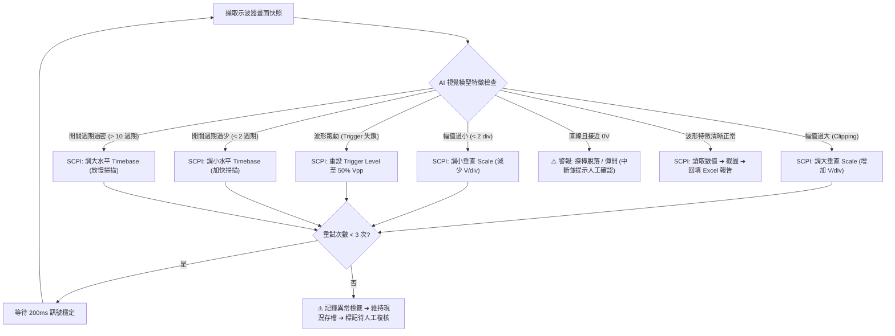

# VR / POL 測試架構專題匯報與 AI 自主量測演進提案

> **文件定位**：本文件整理自硬體/電源驗證工程團隊內部技術匯報與架構評審。包含 10 分鐘專題簡報大綱、現場實戰逐字講稿、MECE 異常處理架構、兩階段落地路線圖與主管問答攻防劇本。
> **核心目標**：解決目前電源測試「八成時間耗在調旋鈕與填 Excel」的痛點，從現有 Python 半自動化引擎出發，逐步過渡到具備視覺反饋與閉環自癒能力的自主量測系統。

---

## 📑 目錄 (Table of Contents)

1. [專案背景與痛點剖析](#1-專案背景與痛點剖析)
2. [技術可行性與邊界評估](#2-技術可行性與邊界評估)
3. [10 分鐘專題匯報：投影片大綱與逐字講稿](#3-10-分鐘專題匯報投影片大綱與逐字講稿)
   - [Slide 1: 現況痛點與主題切入](#slide-1-現況痛點與主題切入)
   - [Slide 2: 解決方案架構與已驗證成果](#slide-2-解決方案架構與已驗證成果)
   - [Slide 3: 從「腳本」邁向「自主判讀」的技術拐點](#slide-3-從腳本邁向自主判讀的技術拐點)
   - [Slide 4: MECE 異常識別與閉環自癒機制](#slide-4-mece-異常識別與閉環自癒機制)
   - [Slide 5: 漸進式導入路線圖與資源估算](#slide-5-漸進式導入路線圖與資源估算)
   - [Slide 6: 效益量化與投資報酬率 (ROI)](#slide-6-效益量化與投資報酬率-roi)
   - [Slide 7: 結論與下一步行動](#slide-7-結論與下一步行動)
4. [MECE 異常自癒處方矩陣](#4-mece-異常自癒處方矩陣)
5. [高階主管 Q&A 實戰攻防劇本](#5-高階主管-qa-實戰攻防劇本)

---

## 1. 專案背景與痛點剖析

在伺服器主機板與高效能運算平台中，電壓調節模組（Voltage Regulator, VR）與負載點轉換器（Point of Load, POL）的測試項目繁多且嚴苛。涵蓋 Ripple & Noise、Dynamic Transient、FSW、MOSFET Vds Switching Waveforms、Jitter、OCP、SCP 與 Turn-on/off Sequence 等。

工程師在實驗室面臨的實際窘境：
- **大量低價值重複勞動**：一套完整的測試矩陣常包含十餘項 Rail、多種負載模式與溫度條件。工程師測試 8 小時，往往有超過 5 小時在手動切換示波器 Timebase/Scale、設定 Trigger、存檔截圖、複製貼上儲存格。
- **傳統純腳本的脆弱性**：純 SCPI 自動化腳本在理想狀態下運作良好，但缺乏「眼睛與常識」。一旦探棒彈開、訊號垂直過載（Clipping）或接地雜訊突發，傳統腳本無法自我修正，往往直接儲存無效圖檔或拋出 Timeout 異常而崩潰中斷。
- **報告格式脆弱與維護成本高**：不同專案的 Excel 驗證報告樣式各異，硬寫欄位代碼會導致腳本無法跨專案複用。

---

## 2. 技術可行性與邊界評估

導入多模態 AI（Vision-Language Models）輔助示波器操作並非空想，但必須劃清「可行」與「不可行」的工程界線：

| 評估維度 | 目前技術「可行」範圍 (Feasible) | 目前技術「不可行」或高風險範圍 (Non-feasible / Out of Scope) |
| :--- | :--- | :--- |
| **視覺判讀能力** | 示波器螢幕特徵辨識：波形截頭（破表）、波形振幅太小（< 2 div）、底噪過大、Trigger 失鎖浮動、文字/量測欄位缺失。 | 靠肉眼算像素來取代示波器內部 12-bit ADC 硬體量測值（絕對禁止，數值必須回歸儀器 SCPI 讀取）。 |
| **閉環控制能力** | 參數微調（V/div、s/div、Trigger Level、Position）的試錯修正，能在 3 次疊代內將波形調至可量測區間。 | 全自動無人值守測試高風險測項（如 OCP、SCP、極限短路），此類測試必須保留工程師實體在場與硬體保護極限。 |
| **系統反應延遲** | 步驟間 1~2 秒的視覺模型推論延遲（對於總長數小時的驗證流程完全可接受）。 | 毫秒等級的即時硬體保護反饋（安全防護必須走實體線路與硬體 OVP/OCP 機制）。 |
| **資安與部署** | Phase 1 使用本機腳本 + 脫敏圖片呼叫公有 API 進行快速驗證；Phase 2 部署本機 4090 工作站（Ollama / vLLM）完全斷網運作。 | 將包含客戶未公開規格與機密線路名稱的完整報告直連未經核准的第三方伺服器。 |

---

## 3. 10 分鐘專題匯報：投影片大綱與逐字講稿

---

### Slide 1: 現況痛點與主題切入
- **投影片標題**：解放工程師雙手：從重複手動操作到 VR/POL 智慧自主量測架構
- **副標題**：提升驗證效率 80%、消弭人為失誤的漸進式架構演進
- **內容重點**：
  - 驗證現場統計：每塊板子驗證平均需切換示波器設定 > 120 次、截圖與貼表 > 200 次。
  - 時間分配失衡：80% 時間花在機械式重複操作（調旋鈕、排版 Excel），僅 20% 時間能投入異常波形分析與根因除錯。
  - 核心命題：我們能不能讓示波器量測像自動駕駛一樣，既有標準 SOP 腳本跑底層，又有視覺能力處理突發微調？

#### 🎙️ 台上逐字稿 (Slide 1，約 1.5 分鐘)
> 「各位主管、各位同仁好。  
> 
> 今天我想直接切入大家在 Lab 每天都在經歷的痛點：VR 和 POL 的測試。  
> 
> 只要跑過一塊主機板或電源子卡的驗證，大家都有經驗：從 Ripple、Dynamic Load、FSW、Switching 到 Timing Sequence，測項隨便就是七八項起跳。如果再乘上不同負載條件，每塊板子光是切換示波器設定就超過一百次，截圖貼到 Excel 報告裡更是兩三百次的機械重複勞動。  
> 
> 結果就是，我們領著工程師的薪水，每天卻花了將近八成的工作時間在當『示波器旋鈕操作員』和『Excel 複製貼上搬運工』。當我們真的看到異常波形時，往往精神已經被這些瑣碎作業耗得差不多了。  
> 
> 我們今天提出的題目很務實：**如何從現有的半自動化量測架構出發，進一步引進視覺回饋，讓繁瑣的測試流程自動走完，把工程師的時間真正還給電路設計與 Debug。**」

---

### Slide 2: 解決方案架構與已驗證成果
- **投影片標題**：解耦式半自動測試引擎：現有架構與實測成效
- **內容重點**：
  - **三層解耦架構**：測試流程引擎（Engine）+ 儀器驅動（SCPI）+ 配置矩陣（Config）。
  - **動態參數計算**：讀取 SPEC 儲存格，自動算出輕載、中載、滿載電流並提示。
  - **精準圖文回填**：`xlwings` 自動錨定指定格位，填入數值並保持排版整潔。
  - **實測數據**：單一 POL 測項（如 Ripple & Noise 輕中滿載）測試時間由 15 分鐘縮短至 3 分鐘以內，零人為抄寫錯誤。

#### 🎙️ 台上逐字稿 (Slide 2，約 1.5 分鐘)
> 「為了不要好高騖遠，我們先看團隊目前已經落地且跑通的第一階段架構 —— **SemiAutoRunner**。  
> 
> 我們沒有去寫那種很肥大、換個板子就要重寫的義大利麵程式碼，而是採用嚴格的三層解耦設計：  
> 最底層是標準 VISA SCPI 儀器通訊，中層是通用測試引擎，最上層則是全域設定表。  
> 
> 我們只要在設定檔裡指定量測項目與儲存格，系統就會自動推播示波器的 `.set` 參數檔、自動從 SPEC 表算出測試所需電流並提示操作者。工程師確認波形無誤後按一下確認鍵，程式會在 3 秒鐘內完成波形截圖、讀回高精度統計數值、換算單位，並自動把圖文工整地塞回 Excel 對應的欄位中存檔。  
> 
> 目前這套系統在 Ripple、Dynamic、FSW 等核心測項上都已經跑通。實測下來，原本一個測項要花十幾分鐘切換存檔，現在 3 分鐘搞定，完全沒有貼錯圖或抄錯小數點的問題。」

---

### Slide 3: 從「腳本」邁向「自主判讀」的技術拐點
- **投影片標題**：為什麼傳統自動化走不完全程？—— 缺乏「視覺」與「彈性」
- **內容重點**：
  - **傳統腳本的脆弱死穴**：
    1. 探棒接觸不良或訊號微幅飄移 ➔ 傳統程式直接儲存一條廢線，整份報告作廢。
    2. 振幅超出垂直刻度（Clipping） ➔ 傳統量測值讀出極端破表數值，程式不自知。
    3. 觸發失鎖（Trigger Unlocked） ➔ 畫面抖動，量出的頻率或週期亂跳。
  - **新一代架構解法**：在傳統 SCPI 骨架上，掛上多模態 AI「眼睛」（Vision Agent），賦予系統邊看邊調的閉環自癒能力。

#### 🎙️ 台上逐字稿 (Slide 3，約 1.5 分鐘)
> 「但是，只做到這一步夠不夠？老實說還不夠。  
> 
> 傳統純腳本最大的死穴，就是它『瞎了』。腳本只要按下執行，它就假設探棒永遠接觸完美、假設電路波形永遠乖乖落在螢幕正中間。  
> 
> 但各位在 Lab 都知道，現實往往是：探棒稍微滑了一下，訊號只剩一條接地線；或者負載一抽，波形振幅超出示波器上下邊界破表了；又或者雜訊把 Trigger 打掉，整個波形在螢幕上狂抖。  
> 
> 傳統腳本遇到這種情況只有兩種下場：要嘛直接 Timeout 卡死，要嘛傻傻地把破表或平線的圖截下來貼進報告，工程師最後還是要手動重測整份報告。  
> 
> 這就是為什麼我們要提出引入 AI 視覺回饋。我們不需要 AI 去做什麼高深學術研究，我們只需要它具備資深工程師的『常識』：在存檔之前看一眼螢幕，確認波形有沒有破表、Trigger 有沒有咬住、探棒有沒有掉。如果歪了，自己送 SCPI 指令微調回去；真的救不回來，再呼叫工程師處理。」

---

### Slide 4: MECE 異常識別與閉環自癒機制
- **投影片標題**：MECE 異常自癒架構：分級診斷與雙層安全防護
- **內容重點**：
  - **訊號特徵層**：幅值超限（Auto V/div）、時基不當（Auto s/div）、觸發失效（Auto Trig Level）。
  - **物理接觸層**：探棒脫落/彈開（檢測幅值趨近 0 且無特徵）、接地不良高頻毛刺。
  - **系統限制層**：單一測項最多重試 3 次，禁止無限迴圈。
  - **安全邊界機制**：電壓/電流/溫度硬體極限鎖定，AI 只有「微調刻度」的權限，嚴禁自主修改危險負載參數。

#### 🎙️ 台上逐字稿 (Slide 4，約 1.5 分鐘)
> 「在具體實作上，我們用 MECE 原則把實驗室會遇到的波形異常劃分為四大類，並給定明確的處方：  
> 
> 第一類是『垂直幅值異常』：波形破表就降一檔垂直 Scale，波形扁平低於兩個格子就放大一檔；  
> 第二類是『水平時基異常』：看到開關週期少於兩個，就放大 Timebase；太密看不到邊緣，就縮小；  
> 第三類是『觸發異常』：波形在跑，就自動把 Trigger Level 設在 Vpp 的中心 50%；  
> 第四類是『物理接觸問題』：如果量出來只有幾毫伏特且完全沒信號，判定為探棒彈開，這時系統會果斷停止並發出告警通知工程師，絕對不浪費時間。  
> 
> 同時，我們立下嚴格的安全天花板：  
> 第一，微調最多重試 3 次，解不掉就放棄並標註 Warning；  
> 第二，AI 只擁有調整示波器顯示刻度的權限，絕對不允許 AI 自主去改電子負載的抽載電流或電源供應器的供電電壓。量測安全永遠排在第一位。」

---

### Slide 5: 漸進式導入路線圖與資源估算
- **投影片標題**：務實落地路線圖：從混合半自動到自主閉環
- **內容重點**：
  - **Phase 1（當前階段 - 混合半自動 + 視覺判讀驗證）**：
    - 硬體：現有示波器 + 開發筆電。
    - 方式：Python 引擎驅動量測，工程師確認波形；非機密波形以 API 驗證視覺提示詞與修正決策準確度。
    - 時程：現已完成，隨時可上線。
  - **Phase 2（演進目標 - 本機工作站離線閉環測試）**：
    - 硬體：實驗室配置一台配備 RTX 4090 (24GB VRAM) 之專用工作站（預算約 10~15 萬 NTD）。
    - 方式：部署開源多模態模型（如 Qwen2-VL-7B / 72B-int4），透過本機 Web API 與測試引擎整合，完全內網斷網運作，零資安外洩風險。
    - 時程：2~3 個月完成模型微調與閉環驅動整合。

#### 🎙️ 台上逐字稿 (Slide 5，約 1.5 分鐘)
> 「談到導入，大家最關心的通常是：會不會花很多錢？會不會影響現有專案排程？  
> 
> 我們的策略是『零風險、漸進式』：  
> 
> 目前的 Phase 1 完全不花任何額外硬體預算。用現有的示波器和工程師電腦，搭配我們已經寫好的 Python 核心引擎，今天就可以在產線和 Lab 跑半自動化。針對需要視覺判讀的邏輯，我們先在非機密波形上用雲端 API 快速把 Prompt 和決策流程驗證好。  
> 
> 到了 Phase 2，當我們確定流程效益明確，我們只需要申請一台配備單張 RTX 4090 的工程工作站，大約 10 到 15 萬元台幣。我們把開源的多模態視覺模型直接部署在工作站本機。這台機器不用連上外網，完全在實驗室局域網內運作。既不需要支付任何月租 API 費用，更徹底杜絕未公開主機板資訊外流的資安顧慮。」

---

### Slide 6: 效益量化與投資報酬率 (ROI)
- **投影片標題**：量化效益預估與投資報酬率分析
- **內容重點**：
  - **時間節省**：每張板子全測項測試時間從原本 24 小時（手動量測+貼表）縮短至 4~6 小時以內（效率提升 75%~80%）。
  - **品質提升**：Excel 數值與圖表回填失誤率歸零，報告一致性達到 100%。
  - **投資回收期**：以一位硬體工程師時薪 600~800 元計算，每週節省 15 小時，單月即可節省約 4 萬元人力成本。Phase 2 工作站投資在 3~4 個月內即可完全回本。

#### 🎙️ 台上逐字稿 (Slide 6，約 1 分鐘)
> 「我們用數字說話：  
> 
> 一款新主機板 EVT / DVT 階段通常有四到五塊板子要測，每塊板子完整跑完手動量測通常要花兩到三天。引進這套自動化後，單板測試時間直接從三天壓縮到一天以內。  
> 
> 以我們團隊的人力成本來看，每位工程師每週可以省下 15 個小時的打雜時間。換算下來，只要省下三到四個月的時間成本，就足以打平一台高階工作站的所有硬體開銷。  
> 
> 更不用說，所有測試數據和波形圖都是程式端直接對位填寫，杜絕了所有人為疲勞打錯數值、貼錯圖的低級錯誤，報告發給客戶或主管審核的品質與信賴度大幅提升。」

---

### Slide 7: 結論與下一步行動
- **投影片標題**：結論：讓工程師專注於真正的工程價值
- **內容重點**：
  - **即刻行動**：現有專案立即啟用 Phase 1 半自動化系統，在不增加硬體成本下即刻收穫 70% 效率提升。
  - **下一步規劃**：
    1. 收集 Lab 真實異常波形資料集（Clipping、Noise、Detached Probe）。
    2. 建立示波器專用視覺微調提示詞庫。
    3. 提報 Phase 2 本地工作站評估計畫。

#### 🎙️ 台上逐字稿 (Slide 7，約 1 分鐘)
> 「總結來說，這個架構的核心價值不是炫技，而是**務實地把工程師從低價值的重複勞動中解救出來**。  
> 
> 我們今天不需要等 AI 發展到完美才能開始。第一階段的半自動化引擎已經準備就緒，隨時可以在目前進行中的專案上線使用，立刻省下七成以上的貼表時間。  
> 
> 接下來，我們會同步在測試過程中收集典型異常波形，完善我們的自動自癒指令庫，並在下個季度評估引進本地模型工作站，完成最後一塊全自動閉環的拼圖。  
> 
> 以上是我的報告，謝謝大家，請各位主管與前輩給予指導。」

---

## 4. MECE 異常自癒處方矩陣

為確保系統在無人干預或微干預狀態下具備足夠的強韌度，系統將示波器螢幕呈現狀態進行 MECE 分類，並設定明確的觸發條件與處方：

| 異常類別 | 視覺模型判讀特徵 (Vision Feature) | 底層處方 (SCPI Remediation) | 最大重試 | 失敗降級方案 |
| :--- | :--- | :--- | :---: | :--- |
| **垂直過載 (Clipping)** | 波形頂部或底部被截平，觸及螢幕上下格線邊界 | 垂直刻度增加一檔（如 `CH1:SCALE 0.05` ➔ `0.1`） | 3 次 | 記錄 `[CLIP_WARN]`，維持現狀截圖並通知人工確認 |
| **垂直過小 (Underflow)** | 總波形高度小於 1.5 格（垂直解析度不足） | 垂直刻度減小一檔（如 `CH1:SCALE 0.5` ➔ `0.2`） | 3 次 | 記錄 `[LOW_RES_WARN]`，繼續執行 |
| **觸發失鎖 (Trigger Loose)** | 螢幕出現多重重疊波形、畫面無規律左右飄動 | 設定 Trigger Level 至目前 Max/Min 的 50% 處 | 2 次 | 切換為 Single 觸發模式嘗試鎖定一次 |
| **水平週期過密** | 顯示超過 15 個以上 Switching 週期，邊緣細節不清 | 水平 Timebase 加快一檔（縮小 s/div） | 2 次 | 維持現有截圖 |
| **水平週期過疏** | 螢幕內 Switching 週期不足 1.5 個，無法評估穩定度 | 水平 Timebase 放慢一檔（放大 s/div） | 2 次 | 維持現有截圖 |
| **探棒接觸不良/彈開** | 訊號近乎直線、Vpp < 5mV 且與預期規格完全不符 | **不重試**：判斷為硬體接線物理故障 | 0 次 | 立即暫停測試流程，彈出視窗並發送通知提示接線 |

---

## 5. 高階主管 Q&A 實戰攻防劇本

面對部門主管、技術主管（Tech Lead）或專案經理（PM）的質詢時，回答必須立足於**數據準確性**、**成本效益**與**資訊安全**：

---

### ❓ 問題一：「如果 AI 模型出現幻覺（Hallucination），亂調參數導致測試數據作假，或者更糟把示波器和板子搞燒掉怎麼辦？」

#### 🛡️ 實戰防禦回答：
> 「這點主管請完全放心，我們在系統設計時就建立了**『權責分離』**與**『硬體防呆』**兩道防火牆：
> 
> 第一，**AI 絕對不碰數值量測**。報告上所有的 Vpp、頻率、時間數據，一律是由示波器內部的硬體 ADC 透過 SCPI 指令直接讀回記憶體寫入 Excel。AI 完全沒有權限去捏造或修改任何數值。
> 
> 第二，**AI 的權限僅限於『示波器視覺觀看角度』**。也就是說，它能微調的只有示波器的垂直 V/div 和水平 s/div，讓圖形被看得更清楚。它被完全禁止去變更電子負載的抽載電流或電源供電器的輸出電壓。板子的供電與散熱邊界完全受控於我們預設的硬體規格表，因此絕不可能發生燒板或數據作假的情況。」

---

### ❓ 問題二：「建一台 RTX 4090 的本機伺服器要花 10 到 15 萬，現有專案真的有迫切需要投這筆預算嗎？」

#### 🛡️ 實戰防禦回答：
> 「我們目前的策略是**『小步快跑，成果說話』**，不需要馬上花這筆錢：
> 
> 我們今天上線的 Phase 1 半自動化系統，使用既有的筆電和示波器，硬體成本是 **0 元**。光是 Phase 1，就已經能幫我們團隊吃下 70% 的截圖和貼表工時。
> 
> 接下來這兩個月，我們會用現有的半自動化系統在實際專案上跑，把節省的具體工時與發現的波形自癒案例數據化。當我們能證明『每週確實為團隊省下 60 個工程小時』時，10 萬塊的工作站預算只要不到一個月的人力回饋就能回收。屆時我們再來向部門正式立項申請 Phase 2，風險完全受控。」

---

### ❓ 問題三：「我們公司的客戶規格與板子線路都是極機密，讓 AI 看波形圖會不會有資安外洩風險？被客戶 Audit 怎麼交代？」

#### 🛡️ 實戰防禦回答：
> 「這正是為什麼我們堅持 Phase 2 必須走**『完全離線本機工作站』**架構：
> 
> 示波器擷取出來的波形圖片，透過專用 Switch 傳輸到實驗室內網的工作站。工作站上運行的開源多模態模型（如 Qwen2-VL）完全在本地記憶體與顯卡推論，整台機器實體斷開外部網際網路，沒有任何封包會流出實驗室。
> 
> 即便是在目前的 Phase 1 驗證階段，我們送出的也是完全脫敏的局部波形圖，不帶任何客戶名稱、專案代號或敏感 SPEC 欄位。資安標準完全符合公司與客戶的稽核規範。」

---

## 6. 總結

本提案並非取代硬體工程師的專業判斷，而是透過分層架構與多模態技術，將繁瑣的重複量測日常轉變為可自我修復、高效產出的工程生產力引擎。現有核心模組已完備，隨時可展開實證。
