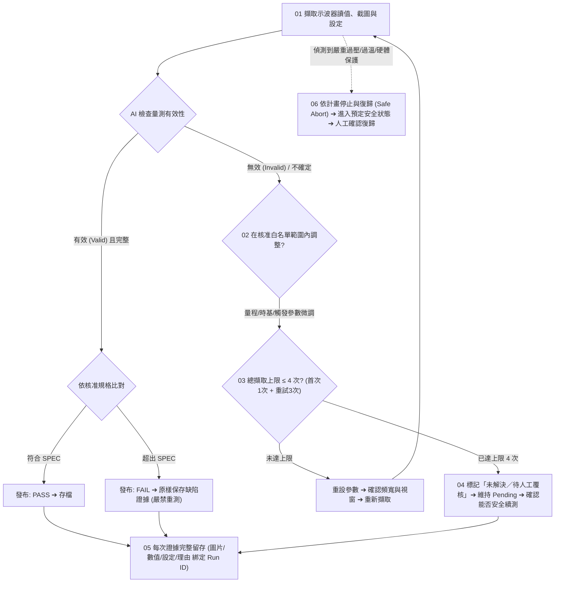

# VR / POL 電源測試：半自動化成果與受控 AI 品質檢查試點提案

> **文件定位**：本文件整理自硬體/電源驗證工程團隊技術審查與匯報架構。  
> **核心原則**：先驗證量測品質，再逐步開放限定範圍的自動重測。分清「已實作、待改善、本期提案」，以具備可審計性、保留全證據鏈的「有人監督受控試點」推進。

---

## 📑 目錄 (Table of Contents)

1. [能力邊界與工程現況 (Current Status)](#1-能力邊界與工程現況-current-status)
2. [現場品質問題與處置依據 (Field Quality Issues)](#2-現場品質問題與處置依據-field-quality-issues)
3. [現況與設計邊界：雙軌獨立判定 (Architecture & Boundaries)](#3-現況與設計邊界雙軌獨立判定-architecture--boundaries)
4. [受控流程設計：限定調整、有限重試與安全停止 (Controlled Workflow)](#4-受控流程設計限定調整有限重試與安全停止-controlled-workflow)
5. [平行驗證路徑：AI 判圖與負載控制 (Parallel Paths)](#5-平行驗證路徑ai-判圖與負載控制-parallel-paths)
6. [試點驗收矩陣 (Pilot Acceptance Matrix)](#6-試點驗收矩陣-pilot-acceptance-matrix)
7. [資源請求與下一步行動 (The Ask & Next Actions)](#7-資源請求與下一步行動-the-ask--next-actions)
8. [附錄：後續方向 —— 異常案例比對與知識累積 (Appendix)](#8-附錄後續方向--異常案例比對與知識累積-appendix)
9. [10 分鐘匯報現場逐字講稿對照 (Presentation Script)](#9-10-分鐘匯報現場逐字講稿對照-presentation-script)

---

## 1. 能力邊界與工程現況 (Current Status)

```
┌────────────────────────────────────────────────────────────────────────┐
│                        工程現況三層邊界劃分                            │
├─────────────────┬──────────────────────────────────────────────────────┤
│ 【已實作】      │ • 示波器設定自動載入、SCPI 數值量測讀回              │
│ 半自動量測回填  │ • Excel 圖文對位自動回填                             │
│                 │ • 讀值例外逐格標記 MEAS_ERR (杜絕 0.0 偽數值)        │
│                 │ • 工時效益待量測基準確認                             │
├─────────────────┼──────────────────────────────────────────────────────┤
│ 【待改善】      │ • 負載切換與波形確認目前仍需人工參與                 │
│ 現場人工作業    │ • 人工仍需在場確認波形品質                           │
│                 │ • 無效擷取可能增加事後覆核與重測工時                 │
├─────────────────┼──────────────────────────────────────────────────────┤
│ 【本期提案】    │ • 有人監督的受控試點，驗證 AI 品質檢查可靠度         │
│ 受控試點閉環    │ • 保留有效量測的 FAIL (嚴禁洗圖重測)                 │
│                 │ • 負載控制同步驗證，共同驗收後再行擴充               │
└─────────────────┴──────────────────────────────────────────────────────┘
```

---

## 2. 現場品質問題與處置依據 (Field Quality Issues)

現場三種典型情境與處置標準：

### 01. 擷取或觸發異常 (Capture & Trigger Anomalies)
- **可能現象**：截圖呈現空白、垂直破表截頭 (Clipping) 或畫面未更新。
- **確認方式**：必須核對觸發狀態、垂直/水平量程與示波器擷取狀態，不能只看截圖外觀。
- **處置原則**：無效證據保留留存；待測物 (DUT) 規格結果維持 `Pending`。

### 02. 疑似量測環境雜訊 (Measurement Environment Noise)
- **可能現象**：波形出現高頻毛刺或底噪異常放大。
- **確認方式**：先檢查治具接地、探棒接觸與量測環境，再行區分係量測干擾抑或 DUT 本體行為。
- **處置原則**：AI 提供品質疑點標記；工程師依需求追加量測以確認原因。

### 03. 振鈴與規格判定 (Ringing & Spec Compliance)
- **可能現象**：瞬態響應出現過衝 (Overshoot)、下陷 (Undershoot) 或振鈴 (Ringing)。
- **判定依據**：必須依照**已核准的 Rail 規格書**，量化過衝幅度（如 $> 10\%$）與穩定時間（Settling Time）。
- **處置原則**：**有效量測即使 FAIL，也應原樣保存**。

> **核心準則**：試點先改善證據品質與覆核效率。異常原因及 DUT 合格與否，仍須依量測條件與核准規格判定。

---

## 3. 現況與設計邊界：雙軌獨立判定 (Architecture & Boundaries)

### 數值處理：既有功能與待補檢查
- **已實作**：儀器硬體量測，SCPI 讀回。讀值例外逐格標記 `MEAS_ERR`，嚴禁偽數值。
- **待補檢查**：通道配置、探棒衰減比 (1X/10X)、無效值與模擬數據過濾檢查。
- **待驗收**：整筆測試結果的正式放行檢查機制。

### AI 品質檢查：本期開發與驗證
- **評估範疇**：評估截頭、擷取狀態與疑似雜訊。
- **輸出狀態**：評估結果包含 `有效 (Valid)`、`無效 (Invalid)` 及 `不確定 (Unknown)`。
- **驗證方式**：先以核准樣本驗證 FAR / FRR；端到端延遲與逾時另行實測。

### 設計原則：雙軌獨立判定矩陣
**鐵律：證據有效且資料完整，才發布 DUT 規格結果！**

```
┌────────────────────────────────────────────────────────┐
│                  量測結果雙軌判定矩陣                  │
├──────────────────────┬─────────────────────────────────┤
│ 維度一：量測有效性   │ Valid  ／  Invalid  ／  Unknown │
├──────────────────────┼─────────────────────────────────┤
│ 維度二：DUT 規格結果 │ PASS   ／  FAIL     ／  Pending │
└──────────────────────┴─────────────────────────────────┘
```
- **有效量測的 FAIL 原樣保存**：真實缺陷證據不得覆蓋。
- **無效或不確定維持 Pending**：不以重試覆蓋原始不良證據。

---

## 4. 受控流程設計：限定調整、有限重試與安全停止 (Controlled Workflow)

> **注意**：本流程為本期設計，待實作與驗收。



### 流程六大防線規範：
1. **01 擷取與有效性檢查**：先保存讀值、截圖與設定。AI 提供品質建議。證據有效且資料完整，才依規格產生結果。
2. **02 核准範圍內調整**：僅調整白名單中的量程（V/div）、時基（s/div）與觸發參數。調整後重新確認擷取狀態、頻寬限制與量測視窗。
3. **03 總擷取上限 4 次**：首次 1 次，最多重試 3 次（總上限 4 次）。另設單次與整步逾時。**有效 FAIL 不進入品質修復重試流程**。
4. **04 未解決交人工覆核**：重試達上限或資訊不足，標記「未解決／待覆核」。先確認能否安全續測，**不直接判為電路故障**。
5. **05 每次證據完整留存**：保留每次圖片、原始值、設定、調整理由及決策。強制綁定 Run ID、DUT、Rail、工況與程式/模型版本。
6. **06 依計畫停止與復歸**：異常時依核准 Test Plan 進入預定安全狀態。**硬體保護獨立於 AI，復歸須人工確認**。

---

## 5. 平行驗證路徑：AI 判圖與負載控制 (Parallel Paths)

兩項工作可平行準備，各自驗證後再進行整合：

### 工作 A：AI 品質檢查（先做資料集與離線判圖驗證）
1. 以**核准可外傳樣本**進行 API 試驗；機密專案波形留在本地。
2. 保留品質判讀所需的刻度與設定；調校集與盲測集分開。
3. 換用本地模型後**重新驗收品質、延遲與逾時**，不沿用雲端成績。

### 工作 B：負載控制自動化（待設備確認後，在人員監督下驗證）
1. 驗證 SCPI 指令與實際讀回，確認定電流及動態負載工況。
2. 依測項定義穩態條件與逾時；**固定延時不等於已穩定**。
3. 依核准保護設計驗證停止行為，確認安全狀態及人工復歸。

> **成本評估範疇**：成本評估完整納入 API 費用、工程工時、後續維護與設備需求。

---

## 6. 試點驗收矩陣 (Pilot Acceptance Matrix)

**各項結果共同審查後再擴充。本期試點不開放夜間無人值守！**

| 驗收面向 | 本期目標／範圍 | 驗證方法與紀錄 | 責任角色 |
| :--- | :--- | :--- | :---: |
| **測項範圍** | Ripple 與 Dynamic Load（限定核准 Rail 與工況） | 先確認測項契約、允收規格及設備／探棒條件 | 測試負責人 |
| **無效圖誤放 (FAR)** | $\text{FAR} \le 2\%$（初期觀察目標） | $\frac{\text{誤放的無效圖}}{\text{全部無效圖}}$；報告張數、信賴區間及工況 | 演算法工程師 |
| **有效圖誤攔 (FRR)** | $\text{FRR} \le 5\%$（初期觀察目標） | $\frac{\text{誤攔的有效圖}}{\text{全部有效圖}}$；**有效的 DUT FAIL 也列入計算** | 演算法工程師 |
| **工時與延遲** | 先建基準，再同條件比較 | 記錄操作、貼表、覆核工時；另量測端到端延遲與逾時 | 測試負責人 |
| **錯誤與停止** | 已定義故障案例全數通過 | 分測通訊、無效值、保護事件；記錄反應時間與安全狀態 | 系統負責人 |

> **初期樣本規模**：盲測 200 張（50 張無效圖 ＋ 150 張有效圖，涵蓋 PASS 與 FAIL）。調校集分開，不確定案例另記；樣本規模只支持初步可行性判斷。

---

## 7. 資源請求與下一步行動 (The Ask & Next Actions)

### 1. 本次資源請求
- **優先借調**符合測項需求的可程控電子負載機。
- 確認工作電壓、電流、功率與動態負載能力。
- 指派測試、軟體及安全審查負責人。

### 2. 共同驗收條件
- 品質指標、樣本代表性、工時與停止測試共同審查。
- 各項符合要求後，方擴大限定測項受控試跑。
- 設備採購與全面推廣，另依實測成果提出申請。

### 3. 平行啟動工作
- 確認 Test Plan 與設備，量測現況人工工時基準。
- 建立 200 張盲測資料（其中 50 張為無效圖）。
- 分別驗證負載控制與 AI 判圖，再進行整合。

> **本次申請摘要**：設備借調與有人監督試點。API 與工程工時另列預算，後續投資依實測決定。

---

## 8. 附錄：後續方向 —— 異常案例比對與知識累積 (Appendix)

> [!NOTE]
> **此功能列為後續研究，不納入本期驗收範圍。**

1. **案例庫記錄觀察與已確認原因**：
   - 記錄瞬態下陷、振鈴與開關抖動。
   - 區分「量測現象」與「經驗證的故障原因」，附上排查過程及最終處置結果。
2. **相似特徵提供排查方向**：
   - 列出相似案例與適用條件，提出候選原因及追加量測項目。
   - **相似度不等同故障機率**。
3. **每筆案例綁定必要背景 (Metadata)**：
   - 強制綁定 IC 型號與版本、PCB 版次、Rail 名稱。
   - 綁定負載條件、工作模式、探棒及擷取設定；跨專案使用前先確認條件可比性。
4. **工程師確認後回補知識**：
   - AI 僅協助縮小排查範圍，工程師驗證原因並完成設計決策。

---

## 9. 10 分鐘匯報現場逐字講稿對照 (Presentation Script)

### Slide 1: 開場與定位 (約 1.5 分鐘)
> 「各位主管、各位同仁好。  
> 
> 今天向大家匯報 VR 與 POL 測試的現況與受控試點提案。  
> 過去一段時間，我們實作了半自動量測與 Excel 圖文對位回填，並在通訊例外時標記 MEAS_ERR。目前負載切換與波形品質仍需人工在場確認，無效擷取也容易增加事後的覆核負擔。  
> 我們本期的提案定位非常清楚：**這是一個有人監督的受控試點**。核心在於先驗證 AI 品質檢查的可靠度，堅持有效量測的 FAIL 原樣保存，負載控制同步驗證，待共同驗收達標後再評估擴充。」

### Slide 2: 現場品質問題與處置 (約 1.5 分鐘)
> 「現場最常見的三種情境：第一是擷取或觸發異常，例如未更新或破表，這時必須核對狀態，無效證據保留且結果維持 Pending；第二是接地雜訊，AI 標記疑點，工程師追加量測確認是否為環境干擾；第三是動態振鈴，我們必須回歸核准的 Rail 規格量化過衝與穩定時間，**有效量測即便 FAIL 也必須原樣保存**。試點先改善證據品質與覆核效率，合格判定始終回歸核准規範。」

### Slide 3: 現況與設計邊界 (約 1.5 分鐘)
> 「在架構上，我們把『數值處理』與『AI 品質檢查』劃清界線。數值走 SCPI 讀回，待補通道與探棒檢查；AI 只負責評估截頭、擷取狀態與疑似雜訊，給出有效、無效或不確定。  
> 最核心的設計原則是：**量測有效性（Valid/Invalid/Unknown）與 DUT 規格結果（PASS/FAIL/Pending）分開記錄**。只有在證據有效且完整時才發布 DUT 結果；無效或不確定維持 Pending，絕不以重試覆蓋原始不良證據。」

### Slide 4: 受控流程設計 (約 1.5 分鐘)
> 「在流程控制上，所有微調僅限白名單中的量程、時基與觸發參數。我們設定**總擷取上限為 4 次（首次 1 次加最多重試 3 次）**，有效 FAIL 絕不進入品質修復重試。若重試達上限，標記為『未解決／待覆核』，先確認能否安全續測，不直接妄斷為電路故障。此外，每次截圖與設定完整綁定 Run ID 留存，硬體保護獨立於 AI，異常時依 Plan 進入安全狀態並由人工復歸。」

### Slide 5: 平行驗證路徑 (約 1.5 分鐘)
> 「在落地執行上，AI 判圖與負載控制採平行驗證。AI 端先以核准可外傳的樣本進行 API 試驗，調校集與盲測集分開，機密留在本地，日後換本地模型須重新驗收；負載端在人員監督下驗證指令讀回、穩態等待與保護行為。兩項工作各自驗證成熟後再整合，成本完整評估。」

### Slide 6: 試點驗收矩陣 (約 1.5 分鐘)
> 「我們拒絕空泛的口號。首批試點嚴格限定在 Ripple 與 Dynamic Load。我們設定初期觀察目標為無效圖誤放 FAR ≤ 2%、有效圖誤攔 FRR ≤ 5%（有效的 FAIL 也列入計算），並以 200 張盲測樣本檢驗。同時先建立人工工時基準再做同條件比較。**本期試點不開放夜間無人值守**，所有結果共同審查後才考慮擴大。」

### Slide 7: 結論與資源請求 (約 1 分鐘)
> 「最後，我們本次的資源請求非常聚焦：**優先借調 1 台符合測項需求的可程控負載機**，以有人監督的受控試點驗證各項指標。品質指標、樣本代表性、工時與停止保護共同審查通過後，才提出後續設備採購或推廣申請。懇請主管支持設備借調，啟動本期受控試點。謝謝大家！」
